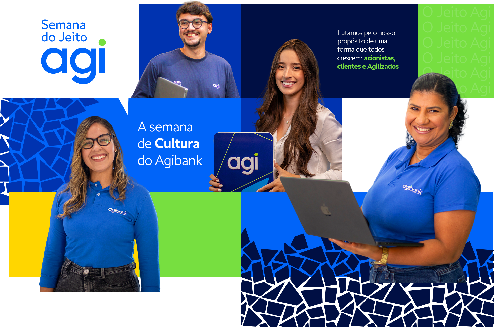
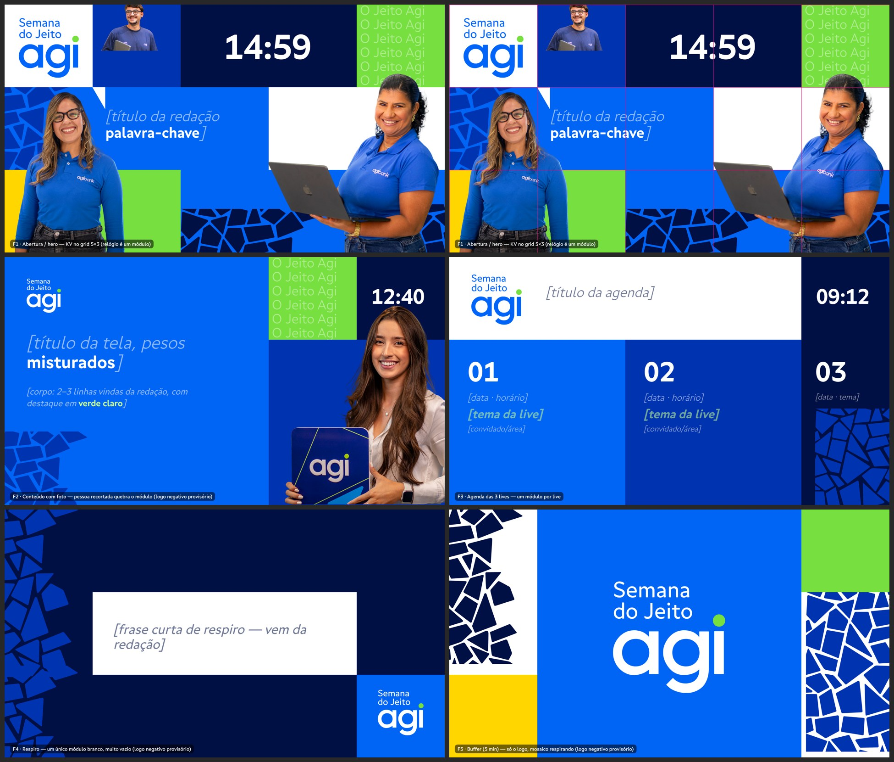

# Estudo: vinheta da Semana do Jeito Agi (3 lives)

**Status:** estudo, antes da redação. Nada aqui é storyboard (etapa 3) nem
`roteiro.json` (etapa 1). Os textos dos frames são **espaços reservados**
(`[...]`) e o copy vem só da redação.
**Data:** 2026-11-25.
**Fontes:** `kv/` (extraído do PSD `KV_semana_do_jeito_Agi.psd`), `brand/tokens.json`,
`brand/boas-praticas-visuais.md` e o histórico do repositório (V1/V2/V3 do MSJ
Nov/2025, retrospectiva 2026).

> **Referências do Vimeo ainda não analisadas.** A rede deste ambiente bloqueia
> `vimeo.com`, então os 3 vídeos (984616986, 1155766903, 1155779113) não foram
> vistos. A seção 5 traz a linguagem de motion tirada do próprio KV; a seção 6
> diz o que será medido nas referências quando houver acesso. Nada foi suposto
> sobre o conteúdo delas.

---

## 1. Formato (igual ao MSJ)

| Item | Valor |
|---|---|
| Resolução / fps / áudio | 1920x1080 · 23,976fps · sem áudio · mp4 |
| Fase 1 (conteúdo em loop) | 10 min |
| Fase 2 (buffer) | 5 min, só o logo, sem texto |
| Total pré-live | 15 min |
| Duração por tela | 10–20s (créditos/grade de nomes até 30s), pela regra do `agents/01` |
| Respiros | entre telas de conteúdo, com texto vindo da redação |

**Um mp4 para as 3 lives.** Isso tem duas consequências:

1. O relógio tem que ser **regressivo relativo** (15:00 → 00:00 a partir do play),
   nunca hora real. Já é assim no MSJ.
2. Nenhuma tela pode dizer "hoje", "nesta live" ou citar a data de uma live
   específica, a menos que a agenda mostre as três igualmente.
   **Alternativa barata:** como tudo é Remotion, gerar 3 mp4 que só mudam um
   parâmetro (ex.: o módulo da live do dia aceso na agenda) custa 3 renders e
   nenhum retrabalho. Decisão sua (pendência P1).

---

## 2. Recapitulação: o que já fizemos

### MSJ Novembro/2025 (abertura): `projects/2025-11_abertura`

Redação com 9 telas (tela_00 a tela_08), loop de 10 min + buffer de 5 min.

| Tipo de tela | Componente | Duração | O que resolve |
|---|---|---|---|
| Início da contagem (relógio grande + logo MSJ) | `PainelContagem` | 10s | abre e volta no meio do loop (V3) |
| Aguarde / respiro | `TelaAguarde` | 10s | quebra a repetição; outline oficial que morfa em volta do texto |
| Destaques do Ciclo (grade de 68 nomes) | `TelaDestaques` | 24s | créditos linha a linha, formas por ato (`GrafismosPorAto`) |
| Indicação + métricas | `TelaIndicacaoMetricas` | 15s | foto recortada saindo da forma (pentagon-06), número grande |
| Conteúdo (Uni Agi) | `TelaConteudo` | 14s | módulo grande com canto de 30px |
| Campanha | `TelaCampanha` | 12s | chamada única |
| Buffer | `BufferLogo` | 5 min | logo MSJ estático com wiggle sutil |

Três direções foram exploradas e renderizadas na etapa 3:

- **V1 "NuDay":** grade fixa de transmissão: relógio parado no meio-esquerda,
  slot de conteúdo à direita que troca a cada tela, logo agi no topo; morph só
  nos respiros e nas transições. Ajustada no Figma e levada até a vinheta
  completa de 15 min.
- **V2 "Mosaico de módulos":** cada tela montada com módulos do Brandbook
  (p.49–54), gap 24px, margem 48px; o relógio é um módulo fixo que nos 10s
  finais cresce até ocupar o mosaico.
- **V3 "Refinado":** layout aprovado + motion refinado: texto revelado por
  máscara, relógio em odômetro, a cor do próximo fundo chega como uma forma
  oficial crescendo, uma forma azul sai do relógio e vira o painel final.

**O que ficou aprendido (vale para esta vinheta):**

- Logos SVG precisam vir com o texto **convertido em contorno** (o logo MSJ
  caía para Times). O logo da Semana extraído do PSD já é contorno (17 paths, 0 `<text>`).
- Formas nunca se sobrepõem nem invadem texto. `CamadaGrafismos` barra o render.
- Respiros funcionam melhor com muito vazio e um único elemento vivo.
- Texto entra uma vez (`TextReveal`) e para. O movimento contínuo fica nos
  grafismos (wiggle 3°/4px a 0,15 ciclo/s).
- Corte seco entre telas é o padrão. Crossfade entre fundos sólidos cria uma cor
  fora da paleta por alguns frames; a transição por forma/cor da V3 resolve isso.
- Os 10s finais precisam de um gesto de fechamento (logo montado letra a letra na V1,
  relógio virando painel na V2/V3).

### Retrospectiva 2026: `projects/retrospectiva-2026`

Não é vinheta de loop, mas deixou dois métodos que servem aqui:
- análise de referência com cortes, ritmo e frames (`referencia/referencia-motion-nubank.md`):
  **planos longos + rajadas curtas** como pontuação;
- estrutura por **refrão** ("Quando a gente tem propósito...") como respiro recorrente.

---

## 3. Análise do KV (PSD)

**Arquivo:** 1957x1296 px, RGB 8 bits. Camadas: `BG` (11 retângulos + 2 grupos
de "cacos"), `IMG PRINCIPAL`, `IMG 02/03/04` (recortes de pessoas), `TXT`
(2 textos), `TEXTURE` ("O Jeito Agi" repetido) e `LOGO SEMANA` (smart object vetorial).

### 3.1 Estrutura: mosaico de módulos sem calha

O KV é uma **grade de blocos retos, encostados uns nos outros, sem gap e sem
canto arredondado**. Linhas em y = 14 / 388 / 760 / 1100 (3 faixas de ~374px) e
colunas irregulares (~520, 400, 400, 300, 300px). Uma cunha branca
triangular (`Rectangle 2 copy`) é a única diagonal.

Coincidência útil: **3 faixas de ~360px fecham exatamente 1080px.** Daí a grade
proposta para o 16:9:

> **Grade 5 × 3 de células de 384 × 360px.** Todo módulo ocupa 1–3 células. O
> relógio, o logo, o texto e as fotos são módulos dessa grade. (Ver
> `frames/F1-hero-grid.jpg`.)

### 3.2 Cores (amostradas no composite)

| No KV | Hex | Token |
|---|---|---|
| azul dos módulos centrais | #0064F9 | `azulAgibank` (#0064F5, diferença de perfil) |
| azul royal / cacos claros | #0033B0 | `azulMedio` |
| marinho / cacos escuros | #000F44 | `azulEscuro` |
| verde (módulo, destaque de texto, pingo do i) | #77DF40 | `verde` |
| amarelo (módulo) | #FFD600 | `amarelo` |
| branco | #FFFFFF | `branco` |

**Tudo dentro da paleta.** Não entra cinza claro: o "respiro claro" aqui é o branco.

### 3.3 Elementos do KV e como viram asset

| Elemento | Origem no PSD | Extraído em | Observação |
|---|---|---|---|
| Logo "Semana do Jeito agi" | smart object `.ai` | `kv/logo-semana-do-jeito-agi-positivo.svg` | vetor, azul + pingo verde. **Só há a versão positiva** |
| Cacos (mosaico) | 4 smart objects `.ai`, todos o mesmo desenho | `kv/cacos.svg` | **56 peças vetoriais separadas**, cantos levemente arredondados, gap branco. O KV usa em `azulMedio` e `azulEscuro` |
| Textura "O Jeito Agi" | 6 linhas de texto Light 25pt, branco a 41% sobre verde | `kv/textura-o-jeito-agi.png` | é tipografia usada como textura |
| Pessoas recortadas | 4 camadas de pixel (já com alfa) | `kv/fotos/*.png` | **baixa resolução** (436–800px de lado) |
| Texto 1 | "A semana / de **Cultura** / do Agibank" Light 42 + Bold | | pesos misturados, como na vinheta de Outubro |
| Texto 2 | "Lutamos pelo nosso propósito... **acionistas, clientes e Agilizados**" Light + Bold verde sobre marinho | | destaque em verde, permitido sobre azul escuro |

### 3.4 Pontos do KV que divergem das regras do projeto (decidir antes do storyboard)

O KV é a peça oficial da campanha. As divergências abaixo não são erro do KV,
mas o `CLAUDE.md` e o `tokens.json` dizem outra coisa. Cada uma precisa virar
**exceção aprovada** em `boas-praticas-visuais.md §6` ou ser ajustada na vinheta:

| # | KV faz | Regra atual | Proposta |
|---|---|---|---|
| E1 | Módulos **sem canto arredondado e sem gap**, encostados | cantos 12–17px (30px se grande); gap 5–8%; margem na borda | Seguir o KV: o mosaico encostado **é** a identidade da campanha. Se não aprovar, aplicar cantos e gap reduz o KV a uma versão da V2 |
| E2 | **Amarelo** como módulo médio (≈520x340) | amarelo nunca é fundo; em módulo, só pequeno | Manter amarelo só em células de 1x1, sempre vizinho de azul, nunca com texto |
| E3 | **Cacos** (textura de mosaico), inclusive `azulEscuro` sobre `azulAgibank` | textura: `azulMedio` sobre azul ou branco; no MSJ, "evitar" | Liberar os cacos como grafismo da campanha, **nunca com texto ou logo por cima** (o KV já respeita isso) |
| E4 | Texto "O Jeito Agi" repetido como textura | não há regra | Tratar como textura decorativa (sem texto de leitura em cima) |
| E5 | **Não usa as formas irregulares oficiais** | MSJ usa formas oficiais + morph | Recomendo **não** usar as formas oficiais nesta vinheta: o papel delas fica com os cacos e os módulos. Misturar os dois sistemas polui o KV |
| E6 | Pessoas recortadas **saindo do módulo** e cruzando outros módulos | precedente só para a foto da Indicação | Estender a exceção para as fotos do KV |

---

## 4. Sistema de frames e telas propostas

Frames de estudo em `frames/` (1920x1080). Contato: `estudo-frames-contact.jpg`.

| Frame | Uso | Composição |
|---|---|---|
| **F1 Abertura / hero** | 1ª tela e retorno no meio do loop (como na V3) | O KV redistribuído no 5x3. Relógio grande ocupa o módulo marinho; logo no módulo branco |
| **F2 Conteúdo com foto** | telas de mensagem/conteúdo da redação | Módulo azul de 3x3 com título (pesos misturados) + corpo; coluna da direita com pessoa saindo do módulo `azulMedio`; relógio compacto num módulo marinho 1x1 |
| **F3 Agenda das 3 lives** | se a redação trouxer a programação | Um módulo por live, numerados 01/02/03, com cores de azul diferentes |
| **F4 Respiro** | intervalos entre conteúdos | Fundo marinho, **um único** módulo branco com a frase, cacos sangrando à esquerda, logo no canto inferior direito |
| **F5 Buffer (5 min)** | Fase 2 | Só o logo num módulo azul central; cacos e dois módulos de acento |

O relógio sempre fica numa célula da grade (canto superior direito, 1x1, marinho),
nunca solto sobre a foto, igual ao "relógio-módulo" da V2.

Telas que provavelmente vão aparecer, conforme a redação: abertura/contagem,
manifesto/propósito (texto 2 do KV), agenda, conteúdo com foto, comportamentos
do Jeito Agi (lista, um módulo por item), respiro e, se houver, uma grade de
nomes (Destaques) aproveitando o `TelaDestaques`.

---

## 5. Linguagem de motion tirada do KV

O KV é feito de **peças encaixadas**: blocos de cor + 56 cacos + pessoas que
"furam" o bloco. A animação deve contar esse encaixe ("cada peça faz parte do
todo"), sem inventar forma nova.

| Gesto | Como funciona no Remotion | Papel (choreograph) |
|---|---|---|
| **Encaixe de módulos** (entrada de tela) | cada módulo entra por máscara a partir da borda mais próxima (`clipPath`/`translate` dentro de um container com `overflow:hidden`), stagger decrescente 4-3-3-2-2 frames, ease-out forte `bezier(0.23,1,0.32,1)` | static → entram antes de tudo, em ~12 frames |
| **Transição tile a tile** | a tela seguinte substitui a atual **célula por célula** (5x3). A cor nova sempre chega como bloco sólido, sem crossfade, então nenhuma cor sai da paleta | substitui o corte seco; é a mecânica da V3 aplicada à grade |
| **Mosaico que se monta** | os 56 cacos vêm com leve rotação e escala 0.95 → 1 e assentam em cascata (ordem pela distância a um ponto). Depois só wiggle mínimo por peça (≤2px, fases diferentes) | decoration |
| **Pessoa saindo do módulo** | o módulo entra primeiro; a pessoa sobe 40–60px de dentro dele (máscara só na parte de baixo) com uma ultrapassagem pequena | lead visual |
| **Texto com pesos** | `TextReveal` por linha; a palavra em Bold/verde entra 3–4 frames depois do resto da linha | lead textual |
| **Textura "O Jeito Agi"** | as linhas deslizam devagar na vertical dentro do módulo verde (loop contínuo) | decoration; **pendência E7:** a regra proíbe motion contínuo em texto, e aqui o texto é textura |
| **Relógio** | dígitos em odômetro (V3), dentro do módulo | static |
| **Buffer** | logo parado; os cacos "respiram" (wiggle sutil); a cada ~20s uma célula de acento troca de cor por tile | mínimo de movimento por 5 min |
| **Fechamento (últimos 10s da Fase 1)** | todos os módulos colapsam tile a tile para o módulo azul central, que vira o palco do logo do buffer | gesto final, como o "relógio vira painel" da V3 |

**Ritmo proposto para o loop:** blocos de 2 telas de conteúdo (12–18s) + 1
respiro (10s), com a abertura/relógio voltando no meio do loop. Com ~8 telas
únicas, uma volta dá ~2 min, ou seja, ~5 voltas em 10 min. Os números finais vêm do
`agents/01` quando a redação chegar.

---

## 6. Referências do Vimeo: o que vou medir quando houver acesso

O pedido é entender composição e ritmo, não copiar. Mesmo método da análise da Nu:

1. detecção de corte (`ffmpeg select=scene`): duração média por plano e onde estão as rajadas;
2. tempo de entrada vs. tempo parado de cada bloco (quanto do plano é animação e quanto é leitura);
3. tipo de transição (corte, wipe, máscara, match-cut por forma);
4. curvas de easing (ease-out longo? overshoot?) e escalonamento;
5. 4–6 frames-chave por vídeo em `referencia/frames/`.

Para isso, preciso de uma destas opções:
- liberar `vimeo.com` (e o CDN de vídeo `vimeocdn.com`) na rede do ambiente; ou
- subir os mp4 (ou gravações de tela) no chat ou no repositório.

---

## 7. Pendências para você decidir

| # | Pergunta |
|---|---|
| P1 | Um único mp4 para as 3 lives (agenda neutra) ou 3 renders com a live do dia destacada? |
| P2 | Exceções E1–E6 da seção 3.4: seguir o KV (minha recomendação) ou adaptar às regras atuais? |
| P3 | Qual logo assina a vinheta: só "Semana do Jeito agi", ou também o logo MSJ / agi? |
| P4 | **Versão negativa oficial do logo da Semana** (branco + verde): os frames usam uma recoloração provisória só para estudo |
| P5 | **Fotos em alta** das 4 pessoas (as do PSD têm 436–800px) e se haverá mais pessoas no manifest. Com 4 fotos em ~5 voltas, cada rosto aparece muitas vezes |
| P6 | E7: textura "O Jeito Agi" com movimento contínuo, sim ou não? |
| P7 | Acesso às referências do Vimeo (seção 6) |
| P8 | Mês/ano das lives, para nomear a pasta `AAAA-MM_semana-jeito-agi` (hoje está `semana-jeito-agi`) |
